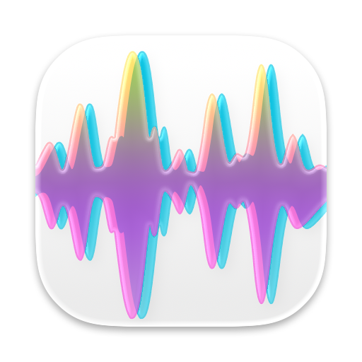

<p align="center">
  <picture>
    <source media="(prefers-color-scheme: dark)" srcset="clap.icon/readme-dark.png">
    
  </picture>
</p>

# Clap Studio

A macOS (SwiftUI + Metal) app to organise and search audio samples for music production.
Point it at a folder; it indexes the files **in place** (nothing is moved, renamed or changed).

The window uses native macOS toolbars, a sidebar and an inspector. On macOS 26
and later, the sidebar keeps the system's glass and scroll edge appearance.
Reduce Motion disables the inspector toggle's animation.

Floating controls on Map and Places use Liquid Glass on macOS 26 and later,
and the map's colours extend beneath the sidebar and inspector. Legends,
waveforms, sample lists and sequencers keep readable content backgrounds.
Filters and map controls wrap when space is tight. Reduce Transparency or
Increase Contrast gives floating panels an opaque background. macOS 14 and 15
keep standard system materials.

- **Similarity search**: select a sample and see the closest-sounding ones (a hi-hat finds other hi-hats).
- **Explore map**: every sample as a dot, laid out by similarity and coloured by cluster. Clusters are named after what is in them (for example "Snare · Bright" or "Hi-hat & Cymbal"); hover a legend row for the breakdown. Hover a dot to hear it, click to select, drag it out into Ableton. Pan with a drag or trackpad scroll, zoom with pinch or mouse wheel, double-click empty space to refit.
- **Shuffle** (⌘R, Library tab): puts the list in a random order so browsing doesn't always start with the same samples. Press again for another order; sorting by a column, or ✕ next to the button, goes back. (Rescan Library is ⇧⌘R.)
- **Preview**: select a row (or press space) to hear it; clicking the waveform plays from that point.
- **Drag and drop** any sample (table row, map dot, the inspector waveform, similar-sounds list) into Ableton or any DAW. Each drag is counted; the "Uses" column and the *Most used* / *Never used* / *Recently grabbed* filters show which samples you keep reusing.
- **Cue points**: read from WAV/AIFF files, edit in the app (click the waveform to audition from a spot, `M` sets a cue exactly there, option-click, drag flags, 1-9 to jump, undo/redo). Edits are saved automatically: the app's database is updated at once and, a moment later, WAV files get the cues embedded (only the cue chunks change; the write is verified and atomic) so other software sees them. Other formats keep their cues in the app only.
- **Sound properties**: loudness, brightness, tempo (loops), pitch or key, and loop vs one-shot are measured at indexing time. They show as sortable columns and filter from the bar above the list and map; the tempo can be corrected in the inspector.
- **Categories**: with CLAP, every sample is sorted into one of 39 categories by comparing it to text descriptions: musical ones (kick, snare, rimshot, cowbell, pad, vocal, ...), sounds of the world outside (birds, water, rain, wind, speech, traffic, machinery, ...) and *Field recording* for long files. They appear in the sidebar and can be overridden per sample.
- **Moods**: nine moods (Aggressive, Rebellious, Powerful, Epic, Dark, Dreamy, Happy, Uplifting, Groovy) are scored with CLAP the same way, but a sound can have several, and each mood is judged against your own library (a sound gets a mood when it stands out for it). They appear in the sidebar, a Mood column and the filter bar, where moods can be combined. They are recomputed when the library changes; most one-shots have no mood. Set your own moods in the properties (tick any number) or for a whole selection from the right-click menu (*Set Mood*: add, remove, clear); they replace the automatic ones, survive recomputing, are undoable, and *Use automatic* brings the automatic ones back.
- **Field recordings**: files of 30 seconds or more are treated as field recordings, and so is any file you put in the Field recording category by hand, however short (it is read again in segments; take the category away and it is read as a single sound again). If a sample was mistaken for a recording, choose *Treat as Regular Sample* from its context menu: the selection is read again as ordinary sounds, even for files over 30 seconds. This choice is remembered and can be undone in one step; the audio files are only read. Setting the Field recording category by hand takes priority over that choice. For short sounds, clearing that manual category restores the sound category found automatically. They are read as a stream (however long), cut at silences (and at 10 s in steady sound), and each segment is embedded on its own after its silent edges are trimmed; the file's own embedding is the length-weighted average of its segments, so the map, clusters and *Find Similar* work as for any sample. They get the *Field recording* category, a *Field recordings* entry in the type filter above the list (one-shots and loops leave them out) and their own map colour. Moods come from the segments, judged against your ordinary samples, and a recording lists every mood any segment has. Searching by description, dropping a file on the window and *Find Similar* score a recording by its best segment and show where it is (an *at 2:05* tag in the list); selecting the result starts playing there. Properties show the number of segments and a *Sounds in this recording* list (birds, water, speech, ...: each segment is named with the same text descriptions as the categories, up to two sounds per segment) with the total time of each and timestamps that start playback there; clicking a sound's name filters the list by it. The sidebar and the Category filter count a recording under each sound heard in it, so *Birds* shows ordinary bird samples and recordings with birds. Tempo, key and pitch are not measured. Existing long files are re-indexed once after updating.
- **Bird species** (optional): with [BirdNET](https://github.com/birdnet-team/BirdNET-Analyzer) installed, field recordings are listened to for birds after indexing (3 s at a time, about 200x faster than real time). *Birds in this recording* in the properties lists each species heard with at least 80% confidence, with its timestamps (click one to play from there) and the confidence of its clearest moment. Tell the app where a recording was made (pick it on a map in its properties, or set a default under Settings, Birds) and species that do not live there are ruled out, using BirdNET's location model; changing the place filters at once and listens to the recording again so the place applies from the start. Create the model files once with `mise exec -- uv run --python "$(mise which python)" --default-index https://pypi.org/simple tools/export_birdnet.py` (downloads about 220 MB; it checks the Core ML output against the original). `scripts/bundle.sh` and the release workflow bundle the model files when they exist (the workflow exports them), so a built app needs no setup. BirdNET's models are CC BY-NC-SA 4.0: a build with the feature is for non-commercial use only, and its notice is included in the bundle (`licenses/BirdNET.txt`). The feature is compiled in by default, and every local and release build includes it for now; build with `NON_COMMERCIAL=0` (`NON_COMMERCIAL=0 scripts/bundle.sh`, `NON_COMMERCIAL=0 scripts/build.sh`, or change `NON_COMMERCIAL` in `.github/workflows/release.yml` for the release workflow) to leave out the code, the models and the notice, for a build you could sell.
- **Places**: recordings that carry GPS (WAV iXML or XMP, MP4/M4A/MOV location, as phones and many field recorders write) are placed when they are indexed, with no BirdNET needed; existing files are read once after updating. The *Places* tab next to Library and Map shows a world map with a pin for each place (nearby recordings share a pin, with their number on it, and bigger groups are bigger); a pin narrows the list below it to those recordings, *Show All* and the scope button reset, and the filters above apply to the pins too. A place you set yourself under *Recorded at* is never overwritten by the file's.
- **File metadata**: what a WAV file says about itself is read when it is indexed (existing files are read once after updating) from iXML, `LIST`/`INFO` and the Broadcast Wave `bext` chunk: title, description, keywords, category, creator, library, originator and date, plus the Universal Category System name when the file is named that way (`DOORWood_Door Slam_BOOM_Library.wav`). The properties show it under *In the file*, and the search box finds samples by it as it does by name and tag, so a purchased library's own keywords are searchable at once. *Use Keywords as Tags* (properties or the right-click menu for any selection, one undo step) turns the keywords into tags. *Write Tags into File…* (properties, or *Write Tags into Files…* in the right-click menu for a selection) puts a sample's category (the `IGNR` genre) and its tags and moods (the `IKEY` keywords) into the WAV file for other software and for a later re-import; the rest of the file's INFO list is kept, the audio is never rewritten, and large files are not read into memory (the file is cloned, only its end changes, the result is checked, and only then does it replace the original; you can keep a `.bak` copy). Files on a USB drive are never changed.
- **Duplicates**: the sidebar's duplicates button finds identical files (same size and same first and last bytes; files that only sound alike are not flagged), keeps the best copy and hides the rest (reversible from the *Hidden* filter; files are never deleted).
- **Favorites and collections**: star samples (`F`) and group them into collections. A collection can hold sub-collections, one level deep: right-click a collection and choose *New Sub-collection…* ("Party #23" with "Opening" inside it). A collection that has sub-collections shows an arrow to show or hide them. Picking it lists its own samples and those of all its sub-collections, each once, and its number counts them the same way; picking a sub-collection lists just its own. A sub-collection cannot have sub-collections of its own, and a collection that has them cannot go inside another (*Move Into* and *Move to Top Level* are in the right-click menu). *Add to Collection* lists sub-collections as *Party #23 › Opening*. *Remove from This Collection* on a parent also takes the samples out of its sub-collections. Deleting a collection that has sub-collections asks first and deletes them too; your samples and audio files are never deleted, and Undo brings the collection, its sub-collections and their samples back. Making, renaming, moving, deleting and filling collections are each one undo step. *Copy To…* (library or map selection) copies several samples to a folder. With a Squid drive connected, right-click a collection and choose *Send to Squid Salmple…* (see below).
- **Sweep**: with a sample selected, `←` and `→` step through its closest sounds, previewing each. Drop any audio file on the window to find library sounds like it.
- **Like this, but…**: whenever the list shows sounds like a sample, a file you dropped or a recording, a box under the filters takes words that adjust the search: *darker, no reverb, more punch*. Phrases are separated by commas; one that starts with *no*, *not*, *less* or *without* (or `-`) is ruled out, and *more* or *with* are optional. The **+** menu adds ready-made words (more or less of dark, bright, warm, punchy, ...). Each phrase is scored against every sample with CLAP's text side, put on the same scale as the sound's own similarity (standard scores) and added or subtracted; only the 300 sounds nearest the original are re-ranked, so words refine the neighbourhood and do not pull in unrelated sounds. Needs CLAP (the text model); without it the box is hidden.
- **Search by humming**: the microphone button in the bar above the list and map listens (up to 10 seconds, ending by itself) and ranks the library by similarity to what it heard (the same search as dropping a file on the window, including field recordings and the similarity aspects). Beatbox a kick, tap a desk, hum a bass line. The recording is only used for the search and deleted; nothing is stored or sent. It needs the app bundle (`scripts/bundle.sh` adds the microphone permission text) and the microphone permission the first time.
- **Ideas**: the lightbulb lists never-used sounds that sit next to the samples you grab most.
- **Project tempo and key**: set them in the toolbar; loops then preview time-stretched to the tempo and tonal sounds transposed to the key (previews only; dragged files are untouched).
- **Map colour, axes and lasso**: colour dots by category, loop/one-shot, usage, tempo, loudness or brightness; lay the map out by any two measured properties instead of similarity; shift-drag a lasso to send the picked dots to a collection, favorites, a tag or Hidden.
- **Similarity aspects**: the sliders under *What counts as similar* weigh overall sound against brightness, pitch (same note), level/punch and length; the list, map highlight and `←` `→` sweep follow.
- **Kit builder**: *Build Kit* suggests a snare, clap, hats and more around a chosen kick, by character, level and pack, with alternatives per slot.
- **Drum machine**: an 8-track sequencer with sixteen steps in each 4/4 bar (toolbar grid button) for trying sounds together at the project tempo. *Try in Drum Machine* in the kit builder loads each pick with a starter rhythm for its category, and ◀ ▶ swaps in the alternatives. *Add to Drum Machine* is in the library context menu. Drag a sample over the drum machine and a line shows where it will be inserted (the middle of a track swaps its sound instead); anywhere below the tracks, even in the status bar, adds it at the end. *File > Open Drum MIDI File…* (⌥⌘O) or a MIDI file dropped over the drum drawer replaces the beat, after asking when it has steps. Each file track containing notes becomes one row (up to eight), reusing that row’s sound or the selected sample for new rows; without a sound, a row keeps its steps as *No sound yet* until you drop a sample on it. Note starts snap to the nearest sixteenth, simultaneous notes become one hit, and pitches and velocities are ignored. The length grows to hold the file in 4/4 bars. Extra tracks are left out with a message. The chooser can also set the project tempo from the file, with its remembered checkbox ticked at first; a dropped file leaves the tempo alone. Files over 32 MB are refused, and MIDI files are only read. Set *Length* to any number of bars by typing, clicking its stepper arrows, or pressing Up and Down while editing; it and *Clear Steps* sit at the right of the drawer header, like the melody’s length and clear controls. Scroll sideways across the steps (a trackpad swipe or Shift and the wheel), or drag the native scrollbar below them; track names and mixer controls stay in place. One full bar fits even with the inspector open at the minimum window width. The compact rows keep the steps beside each sound; during playback the view follows the sounding bar. Growing the pattern leaves the new bars empty, and shortening it removes steps past the end. New tracks and grooves repeat their starter rhythm in every bar; saving a groove captures the first bar. Mute, solo, volume and swing per pattern; set the project tempo in the top toolbar, and tempo changes apply live. Each track has a dice (try a similar sound: same category and one-shot/loop, close to what is there, never one the kit already uses), a back arrow (the sound it had before, up to 20 swaps) and a lock; *Shuffle Kit* (dice in the header) swaps every unlocked track and plays the result, and *Sound variety* beside it shows the chosen setting and sets how far a swap reaches: *Similar* stays close, *Balanced* offers more options, and *Adventurous* reaches further. All three keep the same instrument and one-shot or loop, following the *What counts as similar* sliders. The groove menu offers presets (House, Techno, Drum & Bass, Hip-Hop, Trap, Breakbeat, Reggaeton, Electro): picking one sets the project tempo and swing and gives each sound a rhythm that fits its category. *Save Pattern as Groove…* keeps your own pattern's rhythms, swing and the project tempo as a groove of your own. The choice is remembered between launches and also shapes sounds you add later. The pattern itself (sounds, all bars of steps, mixer, swing, kept in `drums.json` beside the library) and whether the drawer was open are restored on relaunch; sounds that left the library are dropped.
- **Melody**: a piano roll (toolbar piano button) that plays in time with the drum machine, at its tempo and swing and with its play button. It holds up to four sounds, each a track with its own colour; the other tracks show faintly behind the one you are writing. Click a key on the keyboard to hear that note with the track's sound (slide along the keys to play several). Click the grid to add a note, drag a note to move it, drag its right edge to stretch it, click a note (without dragging) or press Delete to remove it; a new note is as long as the last one you drew. *Add Selected*, *Add to Melody* in the library menu, or dragging samples onto the drawer gives the melody more sounds (a full melody leaves the extra ones out and says so); *Use the selected sample* on a track, or dropping a sample on the track's name (it lights up), swaps its sound and keeps its notes. *Plays at* is the note a sample sounds at as recorded (its detected pitch, or C4 when it has none): the other notes are tuned from it like a tape, so pitch and length change together, up to two octaves either way. Each track has mute, solo (shared with the drum machine) and volume. Hover its coloured name tab to reveal an ✕ on the right that removes the track and its notes; the tab’s context menu also has *Remove Melody Track*. The melody is 1, 2 or 4 bars long and starts again at its end while the drums keep looping at their own length. *Open MIDI…* (in the drawer, *File > Open MIDI File…*, or a .mid file dropped on the window) replaces the melody with the notes of a MIDI file, after asking if you have written notes: each track in the file becomes a melody track (up to four), keeping the sound of the track it replaces or else the selected sample, and the melody grows to hold the whole file, however many bars and notes it has (files over 32 MB are refused as not being MIDI songs). A melody wider than the roll shows a window of it: scroll sideways with a trackpad swipe, or Shift and the wheel, and while it plays the window follows the playhead bar by bar. The notes follow the project tempo; the file chooser has a box, ticked unless you untick it, that also sets the project tempo to the tempo in the file (kept between 30 and 300 BPM, and left alone when the file names none). A file dropped on the window never changes the tempo. A fifth track does not fit and is left out, and the app says so; the file is only read, never changed. Trims and sound edits apply to melody sounds as they do in the drum machine. The melody (kept in `melody.json` beside the library, so even a very long one is remembered) and whether the drawer is open are remembered between launches; a track whose sample is no longer in the library (or is on a USB stick that is not plugged in) keeps its notes and waits for a new sound.
- **Trim**: set where a sample starts and ends (inspector, or drag the green edges on the waveform) with a short or longer fade-out. The file is never changed: the trim is stored in the index and used for previews, the drum machine and exports. *Copy To…* writes the trimmed part as WAV, optionally as 16/24-bit, mono and 44.1/48 kHz for samplers. Waveforms and trimming cover the whole file, however long.
- **Edit sound**: under the trim in the inspector, reverse a sample, change its speed (tape-style, -24 to +24 semitones: pitch and length together), take off up to 24 dB or add up to 12 dB (clipped at full scale), and cut highs (*Low-pass*) or lows (*High-pass*) with 24 dB per octave filters. Like a trim, an edit is stored in the index, the file is never changed, and it is used wherever the sample sounds: previews and hover play, the drum machine, *Copy To…* and Squid exports (an edited sample is written as a WAV file as it sounds here). It is one undo step per change, *Play Edited* and *Original* compare, and the drum track names an edited sample. Fades are applied after the edit, so a reversed sound still fades in at its new start. The playhead is not drawn for reversed or sped-up sounds, and similarity, the map and tempo/key stay judged on the original audio. Not included: noise reduction and pitch shifting without a change of length.
- **Squid Salmple** (automatic, no setting): any connected USB drive with an `ALM022` folder is taken as one for the module, and the Squid features appear while it is plugged in and go away with it. Such drives appear in the sidebar with the sets, banks and Pool of the [ALM022 module](https://busycircuits.com/pages/alm022). Banks show their eight channels to hear, drag out or try in the drum machine. *Send to Squid…* (library menu, drum machine, library menu, or the drive) writes up to eight samples as a bank (`Bank N/1…8/Name.wav`, `info.txt`, optionally in a `Set NAME` folder) or any number into the Pool (a dropdown lists the folders already in the Pool, as paths like `Breaks / 707`, and *New folder…* lets you type a name, with `/` to make one inside another; a folder that exists is used as it is), converted to 16-bit 44.1 kHz mono, cut at 11 s and brought to the same loudness as the app's level matching (peaks kept below -1 dB; the sheet's *Match levels* switch turns it off), so samples play at similar volumes. Right-click a drive and choose *Normalize All Samples…* to bring everything already on it to that loudness (after a confirmation): only the audio inside each 16-bit WAV is rewritten, in place, and the category tag and the rest of the file are kept. Samples can also be added to the free channels of a bank that is already on the stick (the number on a bank is how many are free). In the sheet each sample has a channel menu: the channels follow the list order (1 to 8, or the free ones of an existing bank), and picking another channel for a sample moves only that one (the rest fill the gaps; *Automatic Channels* forgets your picks). Two samples on one channel, or a channel you pick by hand that already holds a sample when adding to a bank, shows in red and stops *Send*, so nothing is overwritten there (choose *Replace it* to start the bank afresh); more samples than free channels are marked *not sent* as before. Tick *Same channel in following banks* to send each sample to the same channel of the next bank instead: four snares on channel 2 become channel 2 of banks 1, 2, 3 and 4 (starting at the bank you pick; each row shows its bank; where a bank already has a sample on that channel it is overwritten, with an orange warning per bank (*Bank 3: channel 1 already holds a sample and will be overwritten.*), the channel number turning orange, and no extra confirmation; the old sample is only replaced once the new file is written and checked, and if anything fails the old ones are put back, so a bank is never left half written; new banks take the name you type, a bank that is already there keeps its own, and a set holds 99 banks, so the sheet stops if they run out). You can still give any sample another channel in this mode. Tick *Join samples before sending* (banks only) to join the samples first, as in *Join Samples…* with the *ALM Squid Salmple* limits (mono, 11 seconds, 0.25 seconds of silence, 64 cue sets), into as few files as possible: the first goes to the channel you pick of the bank you start at, and each further file to the same channel of the next bank, so 20 kicks might make 9 on channel 1 of bank 1, 9 on bank 2 and 2 on bank 3. The sheet guesses the number of files before sending and the exact count is known once they are joined; the files are named like the Join sheet names them (*Joined 01*, or your *File name*). A bank whose channel already holds a sample is overwritten, with the same orange warning, and if the banks run out (99 per set) the app says so and sends nothing. Joined files keep their cue markers and their trims and sound edits are applied, but levels are not matched, so each sound keeps its own level, and the joined files are made in a temporary folder that is removed afterwards, so your library files are only read. The sets and banks are managed like folders in Finder: right-click to rename (in place), duplicate, move to another set, reveal or move to the Trash; make new sets and banks; take a single sample out of a channel. The Pool opens in the sidebar to show its folders, and the folders inside them, with how many samples each holds; pick one to see just its samples, or right-click it to send samples there, reveal it or move it to the Trash. In the main list the Pool's samples sit under their folders, which open and close with a click (an empty folder still shows); the usual columns, sorting and menus work inside each folder. A whole collection can be sent in one go (right-click it, *Send to Squid Salmple…*, only while a drive is connected). A collection with sub-collections becomes a new set named after it: each sub-collection becomes a bank (1, 2, 3… in the order the sidebar lists them), named after it, with its samples on channels 1, 2, 3… in the order they were added to it. Samples that are only in the parent itself, not in a sub-collection, are not sent and the sheet says how many. A sub-collection with more than 8 samples shows a red message and nothing is sent until you move some into another sub-collection; a set also stops at 16 named sets on the stick, 99 banks, and a set name that already exists. A collection without sub-collections goes to the Pool as a new folder named after it (a folder that is already there is never mixed into: the sheet stops and asks you to rename); a collection of more than 256 samples, which is all a Pool folder can hold, is split into numbered folders inside it (*Name 1*, *Name 2*…). Names are never changed silently: the sheet shows an orange note when a name is over 8 characters, or when a Pool folder name had to lose characters it cannot hold. If a failure happens part way, a Pool folder made by the send is removed again. Samples in the Pool are taken out the same way: right-click one or several and choose *Move to Trash* (the files go to the Trash, so they can be put back; so does a whole folder). Names are never changed for you: what you type, and what is on the stick, is kept exactly, and an orange warning explains when the module may not read it as written (set names over 8 characters, bank names over 8 characters or with non-ASCII ones, which it shows cut). Names a folder cannot hold (`/ : * ? " < > |`) are refused. Folder names are matched without regard to case, as on a FAT32 stick. Each file sent keeps its category: it is written into the WAV as a standard `LIST`/`INFO` genre entry after the audio, and when the app reads the stick it uses that category (instead of its own guess), so the drum machine finds the right groove parts for a bank. Files without the tag are categorised automatically as before. Existing banks are never overwritten silently. Samples on a stick are analysed but kept out of the library, the map and the saved index, and are never written to.
- **VST3 effects**: open the toolbar's Effects drawer, *Sample > VST3 Effects…* (⌥⌘E), the Library or Map context menu, or the inspector button. *Add Effect* builds a chain from left to right; bypass, move or remove each card. The built-in *Amplifier* adds saturation, with Drive, Tone, Output and Dry/Wet controls; it works alongside installed effects for both auditions and bounces. *Erosion* adds grain and digital distortion with Frequency, Amount, Noise Blend, Filter Width and Stereo Width controls. Scroll within a card to reach all its controls. *Reverb* adds a room sound with Predelay, Size, Decay, Damping, Stereo Width and Dry/Wet controls. The built-in *Low-pass Filter* cuts highs and *High-pass Filter* cuts lows, each with Cutoff, Resonance, Slope (12 or 24 dB per octave) and Dry/Wet controls. Cutoff moves from 20 Hz to 20 kHz on a logarithmic scale, limited below half the sample rate. The drawer finds VST3 bundles in `~/Library/Audio/Plug-Ins/VST3` and `/Library/Audio/Plug-Ins/VST3`, including vendor folders; use *Rescan plugins* after installing one. With *Enabled* ticked, select and audition sounds in the Library or Map as usual to hear the chain. *Preview* repeats the selected sound and *Stop* stops it; playback keeps the controls available without a rendering label. The host stays ready and streams short blocks instead of waiting for the whole file to render. *Open Editor…* opens the manufacturer's controls; keep it open while playing sounds to hear parameter changes, or use its *Sample > Preview Sample* command (Space) to repeat the last audition. Presets and hidden settings are kept when the plug-in supports saving them. Effects without a Mac editor use generic parameter sliders; built-in filter cutoffs and slopes show their units. Closing the drawer or unticking *Enabled* returns to dry auditions while keeping the chain for this app session. Effects and the music drawers share space: opening Effects closes the Drum Machine and Melody drawers; opening either music drawer closes Effects. Patterns and music playback are kept. Trim and sound edits apply before the chain; project tempo, key, level matching and preview volume still apply to auditions. *Bounce…* opens the native Save dialog for one selected sample; *Bounce All…* chooses a folder for the Library selection or selected Map dots and applies the same chain afresh to each, adding numbered names when a file already exists. Bounce captures the current editor settings even while its window remains open. Output is stereo 32-bit float WAV at each source's sample rate. Originals, including other library files and hard links, are protected; copies are verified before they replace a chosen destination. Reported tails are included up to ten seconds per effect; *Extra tail* (two seconds by default) gives effects that report none time to ring out. Silent padding at the end is removed while keeping quiet ringing and a short release. *Cancel* stops work and keeps copies already saved; failures are listed. The chain is separate from library edits: it does not affect drum or melody playback, *Copy To…* or *Join Samples…*. The host supports stereo effects and native Mac plug-in editors, without instruments, MIDI or sidechain audio. Plug-ins must support this Mac, 32-bit float stereo processing, 44.1 kHz for auditions and the source sample rate for bounces. Plug-ins run in a separate helper, so a crashed or stuck effect reports an error while Clap Studio stays available. Loading and live helpers stop after 30 seconds without responding; bouncing stops after five minutes without advancing audio.
- **Tags and export names**: free-text tags (searchable, in the sidebar); *Copy To…* names files from a template such as `{category} - {name} - {bpm}`.
- **Join samples**: select several sounds in the Library or Map and choose *Join Samples…* from the context menu or *Sample* menu (⌥⌘J). The sheet lists their order, following the current Library order, and lets you name the files and set the maximum file length, silence between sounds (0.25 seconds by default) and maximum cue sets per file. Joining applies trims and sound edits; old cues are discarded in the copies. Each sound or split piece gets a named WAV start marker and an exact region length. More files are made when the length or cue count would be exceeded, including the silence between sounds; there is no silence before the first or after the last sound. A sound longer than the maximum continues across multiple files without added silence, repeated audio or lost audio. Shorter sounds stay intact. Output is 16-bit 44.1 kHz WAV; choose mono or stereo. Save these settings as named presets; saving the same name updates it. The built-in *ALM Squid Salmple* preset uses mono, 11 seconds, 64 cue sets and 0.25 seconds of silence. The module converts WAV start markers into cue sets; exact region-end support on hardware has not been verified. Maximum length and silence are limited to 300 seconds to keep joining manageable. Unedited sources stream from disk; very long sounds with sound edits may need trimming first because applying those edits needs the whole sound in memory. *Choose Folder…* opens the native folder chooser; cancelling it returns to the settings. The *File name* box starts as *Joined* each time the sheet opens; type `kicks` and the files are *kicks 01.wav*, *kicks 02.wav*, and so on (two digits, more once past 99). Characters a file name cannot hold (`/ : \`) become `-`, and an empty name means *Joined*. When a name already exists, the new file gets an extra number (*kicks 01 2.wav*) and the old file stays as it was. All copies are checked before they appear in the chosen folder, which opens in Finder afterward. Clap Studio remembers which source pieces were used in each new joined file, including files saved outside indexed folders. Once indexed, find these files under the Joined type filter; All also includes them. Expand a joined row to see its source pieces in order, and select a source to audition it or use the usual sample actions. Sources removed from the library remain listed by name as “Not in library”. Files joined before source links were added cannot be linked automatically. If a rescan detects that a joined file was replaced, it forgets its old source links. If the file cannot be read for verification, the links stay saved but are hidden until a later successful rescan. Checking links reads each joined file in full after export and when first indexed or changed; unchanged files are not reread on rescan. *Cancel* in the status bar stops joining. Source files and existing destination files are never changed.
- **Everyday**: multi-select with batch actions, undo for hide/favorite/tag/collection edits (option-command-Z), folders are watched and rescanned automatically; right-click an added folder and choose *Rescan* to check it now. Previews can be level-matched.
- **Training data export** (Settings, Developer): *Export Embeddings…* writes a new folder with `embeddings.npy` (float32, one 512-number row per sample), `labels.csv` (path, category, whether it is a manual or automatic label, CLAP's own category and confidence, file fingerprint) and `metadata.json`. Samples whose category you set by hand export with it; *Manual labels only* leaves out the automatic ones. Field recordings and samples without a category are not exported, and the library is not changed. Load it with:

  ```python
  import numpy as np, pandas as pd
  X = np.load("embeddings.npy")            # (N, 512), row i belongs to labels.csv row i
  labels = pd.read_csv("labels.csv")       # train on labels["category"]; group by "fingerprint" to split duplicates apart
  ```

## Updates

Read [the changelog](CHANGELOG.md) for features, fixes, and other changes in each
version. GitHub release pages use the same notes.

Pushing to `main` checks the app version before building a release. A release is
published only when that version is newer than the latest published version;
another build of the same version or an older version is skipped. The version is
checked again before publication. If GitHub cannot confirm the previous release,
publication stops.

The app bundle checks GitHub for a newer release every time you open it and, while it
is running, once a day.
When one is available, a pop-up offers **Update**, **Later**, or **Skip This
Update**. The dialog includes scrollable release notes so you can read what
changed before updating. Older releases without notes say so. Update downloads
the app from GitHub, checks its release checksum and app signature, and installs it in `/Applications`. A spinner at the bottom of the
window shows whether the app is downloading or verifying and installing, so you
can keep working while it finishes. If that folder is not
writable, it uses `~/Applications`; the restart prompt shows the exact location.
The previous app is kept until the new one passes verification and its download
quarantine is removed, so in-app updates can reopen without **Open Anyway**.
The first browser download may still need **Open Anyway** in System Settings.
**Restart**
opens the installed update after Clap Studio has saved its work; **Later** lets
you keep working and open the new app yourself. Your samples and library are kept.
Skipping applies to that release only; a later build can still be offered.
**Clap Studio > Check for Updates…** checks immediately, including a release you
skipped. Older releases without an app and checksum offer **Open Release** for
manual installation instead.

Checks read only the public releases of `TommasoAmici/clap-studio`; no samples or
library information are sent. The repository must be public for checks to work.
While it is private or you are offline, automatic checks stay quiet and a manual
check explains why it could not finish. Unbundled development builds have no
release version and do not check automatically.

## Persistence

All expensive results are stored in `~/Library/Application Support/ClapStudio/library.sqlite` (override with `CLAP_DATA_DIR`): file index, embeddings (and the segments of field recordings), PCA, clusters, map coordinates, usage and cues. Relaunching loads them straight from disk; only new or changed files are processed, in batches, so an interrupted index resumes. Moved or renamed files are matched by a content fingerprint and keep their embedding, usage and cues. Storage, cached map loading, similarity search, projection, clustering and map selection are tested with 100,000 samples; analysis reads embeddings in 4,096-row batches.

## Build and run

The app runs on macOS 14 or newer. Building and testing needs **Apple Swift 6 or newer** and a macOS SDK; the Swift Testing suite needs the compiler's Testing plugin too. There is no Xcode project and no Swift package dependency to install. Python and neural models are optional.

Install Apple developer tools first:

- **Full Xcode**: install it from Apple, launch it once to finish installing its components, and select it with `sudo xcode-select --switch /Applications/Xcode.app/Contents/Developer`. If it asks for the license or first-launch setup, finish those before building.
- **Command Line Tools**: run `xcode-select --install` and finish the installer. When their default SDK is macOS 27, this project uses an installed macOS 26 SDK instead: the newer SwiftUI macros need a plugin supplied by full Xcode. If no macOS 26 SDK is installed, use full Xcode or install a Command Line Tools package carrying that SDK from [Apple Developer downloads](https://developer.apple.com/download/all/). The setup check explains this before starting a build.

From the cloned repository:

```sh
scripts/setup.sh --check   # checks the selected compiler, SDK, Testing plugin and Git LFS; installs nothing
scripts/build.sh          # debug build
scripts/test.sh           # unit + end-to-end tests
scripts/bundle.sh         # builds build/ClapStudio.app (ad-hoc signed)
open build/ClapStudio.app
scripts/bench.sh 100000 2048  # optional scale benchmark (also the default)
```

Always use these scripts for builds and tests. They use the compiler found by `xcrun`, so an unrelated Swift on your shell's PATH cannot take over; `scripts/env.sh` selects the SDK and `scripts/test.sh` supplies the Testing plugin path. `DEVELOPER_DIR=/path/to/Xcode.app scripts/setup.sh --check` checks another Xcode without changing the system selection. An explicit `SDKROOT` is honoured; unset it if it names an old or missing SDK. The local configuration checked here is Apple Swift 6.4 with the macOS 26.5 SDK.

Compiler caches stay in `.build/`, so builds also work in shells that cannot write to your home folder. Explicit `CLANG_MODULE_CACHE_PATH` and `SWIFTPM_MODULECACHE_OVERRIDE` settings are honoured.

Before a release, `python3 scripts/check-release-version.py --version X.Y.Z` checks that the version is newer than the latest published release. It uses the GitHub CLI's existing login when `gh` is installed, or a verified HTTPS request otherwise. A failed lookup stops publication.

The VST3 interfaces are vendored, so normal builds need no SDK download. `scripts/vendor-vst3.sh` fetches the pinned revision from Steinberg; add `--latest` to update it, or pass a commit or tag. It replaces the vendor files and updates the revision pin and bundled license notice. See [the bridge notes](Sources/CVST3/README.md), then review the diff and run the build and full tests.

For model export, `mise.toml` pins **uv 0.12.23** and **Python 3.12.9**. [Install mise](https://mise.jdx.dev/getting-started.html) (or `brew install mise` if you already use Homebrew), then:

```sh
scripts/setup.sh           # checks Apple tools; installs the pinned uv and Python through mise
scripts/setup.sh --model-tools  # also creates tools/.venv and installs tools/requirements.txt
# Export CLAP once; downloads its weights and writes the models beside the library:
tools/.venv/bin/python tools/export_clap.py
# Optional BirdNET export uses its own script dependencies:
mise exec -- uv run --python "$(mise which python)" --default-index https://pypi.org/simple tools/export_birdnet.py
```

The setup script can install mise through an existing Homebrew installation when it is missing. It trusts this repository's `mise.toml` and installs only its uv and Python tools. An existing `tools/.venv` with a different Python version is left alone, with instructions to move it aside. Model dependencies follow the ranges in the export scripts and `tools/requirements.txt`; the Swift build does not need them. Exports are separate from setup because they download large models. Without any exported model, the app uses its built-in sound features and the model-dependent tests are skipped. The bundle includes exported models when present (override their folder with `CLAP_MODELS_DIR`); changing embedding models can re-index a large library once.

Images and animations in `media/` use **Git LFS**. Setup installs Git LFS through
an existing Homebrew installation when needed and initializes this repository's
filters and upload hook. It leaves global Git configuration alone and reports
existing hook conflicts instead of replacing them. `--check` also reports the
Git LFS version and changes no configuration.

App builds and tests work with the small LFS pointer files; the release workflow
skips image downloads. To work on the website or view the media after cloning,
run `scripts/setup.sh --media`, or `git lfs pull --include="media/**"` after
initializing Git LFS. Ordinary setup leaves this download optional.
`sh scripts/test-lfs.sh` checks media tracking, a checkout without image
downloads, and restoring the original image bytes from a local cache.

If an installed-model test crashes inside Apple's ML runtime, check the rest of the suite using an empty model folder:

```sh
CLAP_TEST_MODELS_DIR="$(mktemp -d)"
CLAP_MODELS_DIR="$CLAP_TEST_MODELS_DIR" scripts/test.sh
```

This skips the optional model checks; it does not verify those models or change the installed ones. `sh scripts/test-setup.sh` checks the setup diagnostics with fake developer tools, including missing tools, an old compiler, missing SDK/plugins and a Swift shadowing the selected compiler on PATH. It also checks Git LFS installation, optional media downloads, read-only checks and preserving existing hooks.

`scripts/snapshot.sh [out.png] [--select] [--map]` renders the app's window, toolbar included, to a PNG (debug builds only; the script lists the other options). Keep `CLAP_DATA_DIR` pointed at a scratch folder when experimenting: for example, `CLAP_DATA_DIR=/tmp/clap-demo scripts/snapshot.sh /tmp/clap-demo.png`. The usual library is in `~/Library/Application Support/ClapStudio`. For a quick demo library, run `CLAP_DATA_DIR=/tmp/clap-demo build/ClapStudio.app/Contents/MacOS/ClapStudio --add-folder /path/to/samples`. `--update` shows the update prompt using a local example release and its notes, without contacting GitHub; `--update-long-notes` exercises scrolling and `--update-no-notes` shows the missing-notes fallback; `--update-restart` shows the restart prompt without installing or restarting. `--update-download` and `--update-install` show the activity spinner for each stage without downloading or installing anything. Capturing the native macOS alerts needs existing screen capture permission.

`scripts/media-kit.sh` regenerates the website and social images in [`media/`](media/README.md): Library, Map, Drum Machine, Melody, drums with melody together, Places, and Squid Salmple banks, Pool and Send sheet, each in light and dark appearance at 3400 × 2000 pixels. Two silent looping GIFs show drums and melody playing together at 1700 × 1000 pixels. It creates 420 original synthetic samples in a temporary library, including 36 ambience sounds at demonstration places around the world, and copies 54 of them to a demonstration Squid stick inside the same temporary folder. No connected USB drive is needed or used for these captures. A separate demo app preference domain keeps its settings apart, and the temporary files are removed when finished. No personal samples or neural models are needed. The images are native captures of the window, so they show what macOS draws on the Mac running the script, Liquid Glass and toolbar included. That needs screen capture access for your terminal, a Retina display and a Mac that stays awake and unlocked; the script stops with a message if the images are not 3400 pixels wide. It records the demo app as built with the installed macOS SDK, because Command Line Tools builds otherwise get macOS's old toolbar, and uses a 1700-point-wide window because the glass layout needs that width. Pass an output folder to preview a new set elsewhere.

Snapshot options `--standard-effects`, `--reduce-transparency` and
`--increase-contrast` exercise the custom floating panels' glass and opaque
paths without changing your Mac's settings. Native controls still honour
those settings. `--reduce-motion` disables snapshot animations, and
`--map-selection` with `--map` shows the selection actions. Bitmap captures
omit native glass layers; `--native` includes them at the display's
resolution using existing screen capture permission.

The static landing page lives in [`website/`](website/README.md), with screenshots that follow the browser's light or dark appearance, a Drums/Melody/Together preview, and a section for ALM Squid Salmple banks, Pool folders and export. Shared links show a 1200 × 630 preview card with the app icon and sound map. Run `scripts/website.sh` to make a self-contained `build/website` folder ready for a static host, or serve the repository root and open `/website/` to preview the source. The export adds the current app version to image URLs so browsers refresh screenshots after a release. Set `WEBSITE_URL` to the public site address when exporting for correct link previews. It needs no package install or runtime service.

The [Website workflow](.github/workflows/website.yml) checks website changes on pull requests and deploys changes pushed to `main` to `/var/www/html/clap-studio/` on your VPS over SSH, matching the Salmple deployment. See the [website setup](website/README.md#vps-deployment) for the five SSH secrets and server directory. App releases continue to skip media downloads.

## Similarity model

Three embedders sit behind one protocol:

1. **LAION-CLAP on Core ML** (preferred; HTSAT audio tower, 512-d, trained on audio/text pairs). Create it once with `tools/export_clap.py` (the docstring has the `uv` commands). It also exports the text tower and tokenizer files, which makes the one search box semantic: type "punchy 808 kick" or "warm analog pad" and you get files with that name first, then the sounds that best match the description.
2. **PANNs CNN14 on Core ML** (AudioSet classifier trunk, 2048-d). Create it with `tools/export_model.py`. Used when CLAP is absent.
3. **Built-in DSP features** (log-mel band statistics, envelope, centroid). Used automatically when no model is exported; the status bar says so. Good for coarse grouping, noticeably weaker than the neural models.

Models are compiled by the app on first launch. Switching model re-embeds the library once. `tools/make_references.py` regenerates the librosa / Hugging Face ground truth the tests compare the Swift front ends, tokenizer and Core ML outputs against.

Pipeline (CLAP: 10 s window at 48 kHz, repeat-padded; CNN14: 4 s at 32 kHz): standardise the sample, log-mel (vDSP), model, PCA to 128 dims, cosine search (BLAS), spherical k-means for colours, UMAP-style layout for the map.

Standardising (`SamplePreprocessor`, shared by indexing and query-by-example through `EmbeddingInput`): leading and trailing silence cut (loops keep theirs), onset at a fixed 5 ms pre-roll, one gain to -18 dBFS RMS with peaks at most -1 dBFS, quiet files boosted at most 30 dB. Loudness, length, tempo and pitch are measured on the original file, so the level and length aspects stay real; only the embedding sees the standardised sound. Changing this re-embeds the library.

The scale target is 100,000 samples. `scripts/bench.sh` defaults to 100,000 samples x 2,048 embedding dimensions and measures adding and rescanning rows, reopening the library and cached map, streaming embeddings, PCA, clustering, the full map layout, similarity search and hover lookups. It creates its own temporary library and removes it afterwards. The generated data measures library and analysis costs; audio decoding and model inference are covered separately by the end-to-end tests. Timings depend on the computer and the sounds; a full map rebuild does more work than opening a cached map. One run on an M4 Pro with 48 GB of memory took 0.28 s to load the cached map, 4.25 s to fit PCA and 5.10 s to rebuild the map. Similarity queries averaged 0.48 ms over the 128-dimensional projection and 6.74 ms over all 2,048 dimensions.

## Layout

- `Sources/ClapCore`: scanner, storage, audio, ML, indexing, PCA/k-means/layout, cues, playback (no UI).
- `Sources/ClapStudio`: SwiftUI app and Metal map.
- `Sources/ClapBench`: benchmark. `Tests/ClapCoreTests`: Swift Testing suites. `tools/`: model export.
