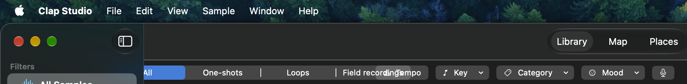
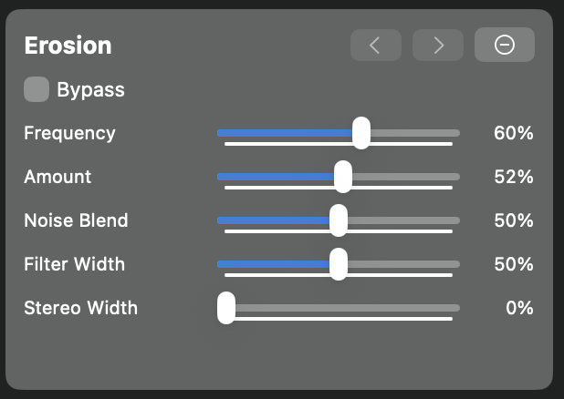
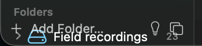

# Bugs

I'm using macOS 27.2

## Filters overlapping

- [x] Fix filters overlapping.

The filters in the top bar overlap: [All|one-shots|loops|field recordings] overlap `tempo`

## Built-in effects

- [x] Fix built-in effects.

There seems to be an extra line for each slider in the built-in effects

## Add folder

- [x] Fix add folder.

The add folder button overlaps the left sidebar and things become unreadable

## Rescan

- [x] Add Rescan to added folders.

Please add a `Rescan` entry in the context menu of added folders

## Performance degradation

- [x] Fix performance degradation.

When using the arrow keys to move up and down the Library tab to preview samples, there is visible
input lag.
This also happens if there are only a few samples in the list. For example, I selected a subfolder
from a folder in the left sidebar with only 267 samples and it lags visibly.

## Implementation context

- `EffectRow` uses a continuous native slider for continuous parameters. A
  tiny step made macOS draw a line of thousands of tick marks. Discrete
  plug-in parameters keep their specified steps.
- `FilterBar` sizes the segmented type picker to its labels. The existing
  `ViewThatFits` then moves property filters onto a second row when needed,
  instead of allowing the picker contents to spill into Tempo.
- `SidebarView` keeps its bottom actions outside the scrolling `List`,
  with a divider, so long sidebars do not scroll under Add Folder.
- The context menu on an added root calls `startIndexing(scanning:)` with
  that root. Indexing and library analysis still process pending work, but
  the filesystem scan only visits the chosen root; the action is disabled
  during an existing index.
  The scratch sidebar snapshot shows an added root; native accessibility
  automation could not locate its row reliably, so invoking the menu and
  confirming a new file is picked up remains a manual check.
- `reloadCues()` only changes sample records when their cue count differs;
  changing `visible` otherwise increments `visibleRevision` and rebuilds the
  table on every selection. `LibraryListCoordinator` reloads visible cells
  only when drum-track or segment-match details actually change.
- Similarity ranking runs off the main actor. A newer selection cancels the
  previous task, and the selected id, index and weights are checked again
  before results are published. `AspectSimilarity.rank` cooperatively stops
  while scoring weighted candidates and never returns partial results; its
  matrix operation and sort cannot be interrupted in the middle.
- `SimilarityCancellationTests` covers cancellation before ranking and while
  scoring. On macOS 26.7.2, a scratch library accepted 20 rapid alternating
  arrow keys and ended on the expected row. No before/after latency timing or
  runtime check on macOS 27.2 was available.
  `scripts/bench.sh 100000 128` completed with 100 similarity queries in
  0.063 s; this measures the core index, not interactive key latency.
