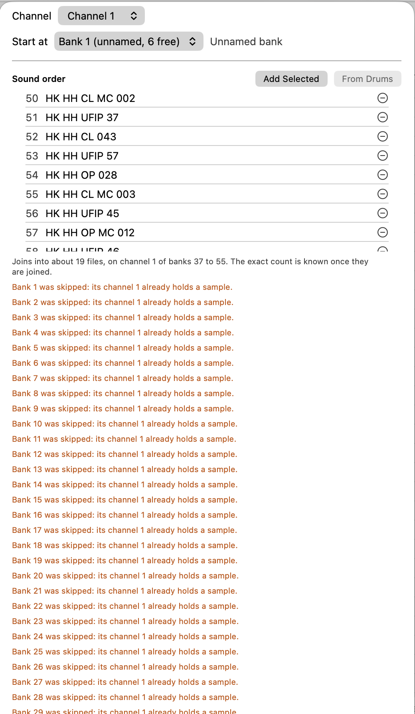

# Bugs

I'm using macOS 27.2

## Filters overlapping

- [x] Fix filters overlapping.

The filters in the top bar overlap: [All|one-shots|loops|field recordings] overlap `tempo`

## Built-in effects

- [x] Fix built-in effects.

There seems to be an extra line for each slider in the built-in effects

## Add folder

- [x] Fix add folder.

The add folder button overlaps the left sidebar and things become unreadable

## Rescan

- [ ] Fix rescan.

Please add a `Rescan` entry in the context menu of added folders

## Performance degradation

- [ ] Fix performance degradation.

When using the arrow keys to move up and down the Library tab to preview samples, there is visible
input lag.
This also happens if there are only a few samples in the list. For example, I selected a subfolder
from a folder in the left sidebar with only 267 samples and it lags visibly.

## Implementation context

- `EffectRow` uses a continuous native slider for continuous parameters. A
  tiny step made macOS draw a line of thousands of tick marks. Discrete
  plug-in parameters keep their specified steps.
- `FilterBar` sizes the segmented type picker to its labels. The existing
  `ViewThatFits` then moves property filters onto a second row when needed,
  instead of allowing the picker contents to spill into Tempo.
- `SidebarView` keeps its bottom actions outside the scrolling `List`,
  with a divider, so long sidebars do not scroll under Add Folder.
